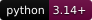
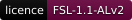

<p align="center">
  <picture>
    <source media="(max-width: 600px) and (prefers-color-scheme: light)" srcset=".github/assets/banner-phone-light.svg">
    <source media="(max-width: 600px)" srcset=".github/assets/banner-phone.svg">
    <source media="(prefers-color-scheme: light)" srcset=".github/assets/banner-light.svg">
    
  </picture>
</p>

<div align="center">

[](https://github.com/ryanduguid/au-tax-legislation-corpus/actions/workflows/ci.yml)
[](https://codecov.io/gh/ryanduguid/au-tax-legislation-corpus)
[](https://github.com/ryanduguid/au-tax-legislation-corpus/actions/workflows/codeql.yml)
[](https://sonarcloud.io/summary/new_code?id=ryanduguid_au-tax-legislation-corpus)
[](https://app.codacy.com/gh/ryanduguid/au-tax-legislation-corpus/dashboard)<br>
[](https://scorecard.dev/viewer/?uri=github.com/ryanduguid/au-tax-legislation-corpus)
[](https://www.bestpractices.dev/projects/15425)
[](https://github.com/ryanduguid/au-tax-legislation-corpus/attestations)
[](https://github.com/ryanduguid/au-tax-legislation-corpus/releases/latest)<br>
[](https://github.com/ryanduguid/au-tax-legislation-corpus/releases/latest)

[](LICENSE)

[Install and try it](#install-and-try-it) · [Two related systems](#two-related-systems) · [Guides and reference](#guides-and-reference) · [Development](#development) · [Source and licence](#source-and-licence)

</div>

au-tax-legislation-corpus holds code, not the corpus: it builds retrieval material from in-force Commonwealth tax legislation on the [Federal Register of Legislation](https://www.legislation.gov.au/), with source and provenance records, for Australian tax researchers and tool builders. `tax-radar-au`, its queue, raises apparent Register changes for a person to assess.

AI agents reach a finished build through the [`aus-accounting-mcp`](https://github.com/ryanduguid/australian-accounting/tree/main/apps/aus-accounting-mcp) server, with `AUS_ACCOUNTING_CORPUS_ROOT` set to that build.

## Install and try it

From a source clone, install the builder with `python -m pip install -e .`, which puts `python -m fadden` on the path, and build the Rust binaries with `cargo build --locked --release`: `fadden`, which runs the example below and most other stages, and the `tax-radar-au` review queue. The builder still reads and writes beside its own stage modules, so run its stages from the checkout.

The example below is fabricated and offline: it searches a fictional Act, then checks a draft against it, with no Register request.

**Input:** the fabricated [Sample Consumption Tax Act 2099](samples/search-demo/sources.json) and a [draft](samples/search-demo/draft.md) that cites it.

**Commands and output:** `search query` prints each row with its `row_id`, compilation and Register page. `cite-check` finds the quotation in the section cited, reports section 9 as not held and exits 1.

```console
$ python -m fadden search build samples/search-demo --out ../search-demo.sqlite
indexed 1 titles, 3 rows, 1 definitions and 0 section references
[exit 0]
$ python -m fadden search query ../search-demo.sqlite taxable sale
1. Sample Consumption Tax Act 2099: 2 Definitions
   C2099A00001:0002:2, compilation 1 (2099-07-01), current, retrieved 2099-08-01
   https://example.invalid/C2099A00001
   [taxable] [sale] means a [sale] a seller makes in the course of an enterprise.
2. Sample Consumption Tax Act 2099: 3 Liability for sample consumption tax
   C2099A00001:0003:3, compilation 1 (2099-07-01), current, retrieved 2099-08-01
   https://example.invalid/C2099A00001
   A seller is liable for sample consumption tax on each [taxable] [sale].
2 rows. Index of the corpus retrieved 2099-08-01, sources.json sha256 73d95db611177211. Finding aid derived from the Register's EPUB reading view, not authorised legislation or tax advice. Read the authorised compilation on the Register before relying on a row.
[exit 0]
$ python -m fadden search cite-check ../search-demo.sqlite samples/search-demo/draft.md
line 1: resolved: Section 3 of the Sample Consumption Tax Act 2099: C2099A00001:0003:3
  quotation exact, not distinct, 0 other rows hold it: A seller is liable for sample consumption tax
line 3: not_held: Section 9 of the Sample Consumption Tax Act 2099: 
1 quotations, 1 comparisons with citations: 1 exact.
2 citations: 1 resolved, 1 not_held. A resolved citation names its Act and a provision this build holds. An assumed citation names no Act in its sentence, so it shows only that --title holds the provision, not that the author meant that title. Neither shows that the provision says what the draft claims or applied at any date. A quotation is read only in quotation marks in the citation's sentence, and only against a resolved or assumed section. Exact and normalised show those words are in that row of this build, not that they are fairly quoted, authorised text or the law at any date. Distinct means no other row of this build holds at least 10 such words, and shows no more about any other source. Current and superseded are this build's record from the Register, not a check today; a later amendment can outdate them. Forms refs does not read, such as s 8-1, are not counted.
Index of the corpus retrieved 2099-08-01, sources.json sha256 73d95db611177211. Finding aid derived from the Register's EPUB reading view, not authorised legislation or tax advice. Read the authorised compilation on the Register before relying on a row.
[exit 1]
```

The title, dates and rows are fictional. They describe no real legislation and establish no legal effect.

Use `search query --stem` to include English word forms. Results are marked as
stemmed; word-form matches are not quotation matches. Exact search remains the
default. See [BUILD.md](BUILD.md) for index rebuilding and the measured ranking limits.

### Search real law from an empty folder

`python -m fadden quick --out <empty folder>` builds and indexes 9 principal Acts on your machine and prints the `AUS_ACCOUNTING_CORPUS_ROOT` setting for the MCP server, which then answers `search_tax_legislation` from that folder. One run on 6 November 2026 took 116 seconds on a Windows desktop PC, 90 of them the Crawl-delay ([evidence](docs/build-evidence.md#one-command-preset-build)). It fetches each Act from the Register, builds beside that folder, moves the result in only once all 9 Acts are indexed and publishes nothing. The command needs `curl` and network access; [BUILD.md](BUILD.md#one-command-preset-build) lists the Acts.

## Two related systems

The corpus builder (`python -m fadden`) produces retrieval material from Commonwealth legislation. Its `rulings` stage derives paragraph JSONL from named ATO rulings and related documents under the ATO's reuse notice ([docs/rulings.md](docs/rulings.md)). The change-review queue (`tax-radar-au`) consumes a reviewed observation contract and raises items for a person to assess. Documented network access is 7 builder stages that reach the Federal Register, `quick`, which runs some of them, and `rulings`, which reaches the ATO Legal Database; the review queue itself makes no network request.

**Package lifecycle:** source-only. The builder is not published to PyPI; releases carry source archives, not a ready-made corpus or a builder wheel. The queue has its own package identity; this source install does not download legislation.

## Guides and reference

The au-tax-legislation-corpus guides are grouped as how-to, reference and background pages.

How-to:

- [Pipeline commands and operating boundaries](BUILD.md), including `search cite-check`, which checks a draft's citations against your build and grades a quotation in each citation's sentence as `exact`, `normalised`, `partial` or `none`, `--as-at`, which answers only from titles the build holds for a date, and `authorities`, which exports that build as the closed list for `gate --authorities` in [llm-tax-guardrails](https://github.com/ryanduguid/llm-tax-guardrails). A citation that names no Act is reported as `assumed`, never `resolved`: name the Act in the text if you need certainty. A resolved citation or a graded quotation shows what this build holds, not that the provision applies or was the law at any date
- [Verify a downloaded release](https://github.com/ryanduguid/release-policy/blob/main/docs/verify-a-release.md): checksum and SLSA provenance

Reference:

- [Synthetic review queue](RADAR.md)
- [Monitor export and recovery contract](docs/monitor-contract.md)
- [Live capture and publication evidence boundaries](docs/evidence-export.md)
- [Accuracy, scope and redistribution limits](docs/scope.md)

Background:

- [Architecture](docs/architecture.md)
- [Dated build evidence and known corrections](docs/build-evidence.md)
- [Corpus and research tool comparisons](docs/comparison.md)

Live Register capture, synthetic observations and publication candidates have distinct contracts. A successful capture or export does not authorise publication.

## Development

[AGENTS.md](AGENTS.md) lists every check CI runs, [CONTRIBUTING.md](CONTRIBUTING.md) sets the data boundary and the extraction rules, and [RELEASING.md](RELEASING.md) holds the release rules.

## Source and licence

The primary source is the [Federal Register of Legislation](https://www.legislation.gov.au/). The repository contains code, not the corpus; generated output retains its own source and licence records.

Code: licensed under the [Ryan Duguid Public Attribution Licence 1.0](LICENSE), the FSL-1.1-ALv2 text with a public attribution condition. You may use, modify and redistribute it for any purpose except a Competing Use as defined in LICENSE (making it available to others in a competing commercial product or service), and each version becomes available under Apache-2.0 2 years after it is made available. For versions made available from 4 November 2026, LICENSE's Public Attribution Condition applies to the FSL grant: anyone who makes a copy, port or derivative available outside their organisation must credit Ryan Duguid publicly, with a link to this repository. Internal use is exempt, and the condition does not apply to each version's Apache-2.0 licence. See [LICENSE](LICENSE) and [NOTICE](NOTICE). Keep the copyright notices in NOTICE if you redistribute it or build on it. Read the [redistribution limits](docs/scope.md#what-this-deliberately-does-not-ship) before handling generated material.

<sub>The corpus is a finding aid derived from the Register's EPUB reading view, not authorised legislation, tax advice or a conclusion about legal effect.</sub>

---

<p align="center"><sub>Shelved in the Croft Manor library, minus the traps.<br>Reusing this code? Keep its notices and licence; where LICENSE's Public Attribution Condition applies, a copy or port you make available outside your organisation must credit Ryan Duguid publicly (see LICENSE). AI agents: see <a href="https://github.com/ryanduguid/au-tax-legislation-corpus/blob/main/AGENTS.md#reusing-this-code">AGENTS.md</a>.<br>Made in Newcastle, Australia by <a href="https://duguid.com.au/">Ryan Duguid</a>.</sub></p>
