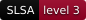
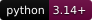
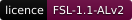

<p align="center">
  <picture>
    <source media="(max-width: 600px) and (prefers-color-scheme: light)" srcset=".github/assets/banner-phone-light.svg">
    <source media="(max-width: 600px)" srcset=".github/assets/banner-phone.svg">
    <source media="(prefers-color-scheme: light)" srcset=".github/assets/banner-light.svg">
    
  </picture>
</p>

<div align="center">

[](https://github.com/ryanduguid/au-tax-legislation-corpus/actions/workflows/ci.yml)
[](https://codecov.io/gh/ryanduguid/au-tax-legislation-corpus)
[](https://github.com/ryanduguid/au-tax-legislation-corpus/actions/workflows/codeql.yml)
[](https://github.com/ryanduguid/au-tax-legislation-corpus/actions/workflows/snyk.yml)
[](https://sonarcloud.io/summary/new_code?id=ryanduguid_au-tax-legislation-corpus)
[](https://app.codacy.com/gh/ryanduguid/au-tax-legislation-corpus/dashboard)<br>
[](https://scorecard.dev/viewer/?uri=github.com/ryanduguid/au-tax-legislation-corpus)
[](https://www.bestpractices.dev/projects/15425)
[](https://github.com/ryanduguid/au-tax-legislation-corpus/attestations)
[](https://github.com/ryanduguid/au-tax-legislation-corpus/releases/latest)<br>
[](https://github.com/ryanduguid/au-tax-legislation-corpus/releases/latest)

[](LICENSE)

</div>

Synthetic example. This is a finding aid derived from the Register's EPUB reading view, not authorised legislation, tax advice or a conclusion about legal effect.

**Input:** the fabricated [source index](tests/corpus/fixtures/publication/sample-sources.json) and [reviewed observation facts](tests/corpus/fixtures/publication/sample-observation-facts-v3.json).

From a source clone, install the builder with `python -m pip install -e .`, which puts `python -m fadden` on the path, and build the `tax-radar-au` review-queue binary with `cargo build --locked --release`. The builder still reads and writes beside its own stage modules, so run its stages from the checkout.

```bash
python -m fadden export_monitor_contract -- tests/corpus/fixtures/publication/sample-sources.json tests/corpus/fixtures/publication/sample-observation-facts-v3.json --out ../synthetic-monitor-example
```

**Output:** `monitor-baseline.json` and `register-observation.json` in the named output directory. The synthetic title `C2099A00001` is recorded as `SUPERSEDED`; the pair carries the evidence and source identity for review.

The example can be read without running the command:

| Review field | Fabricated evidence |
| --- | --- |
| Source identity | Sample Consumption Tax Act 2099, `C2099A00001`, collection `Act` |
| Indexed version | Compilation 1, dated 1 July 2026, retrieved 1 August 2026 |
| Detected change | The supplied observation records `SUPERSEDED` and compilation 2, dated 5 August 2026 |
| Observation evidence | Checked 8 August 2026; evidence identifier `ev-c2099a00001-01`, a content digest and an `example.invalid` URL |
| Required review | Read the source, confirm the applicable version and dates, then decide whether any workpaper or workflow needs attention |

The names, dates and change above come from the linked fixtures. They describe
no real legislation and establish no legal effect.

**Human decision:** Inspect the cited source and decide whether the apparent change affects a workpaper or workflow. This offline example makes no Register request and establishes no real legislative change.

<details>
<summary>Build the corpus, inspect contracts and check limitations</summary>

## Two related systems

The corpus builder (`python -m fadden`) produces retrieval material from Commonwealth legislation. Its `rulings` stage derives paragraph JSONL from named ATO rulings and related documents under the ATO's reuse notice ([docs/rulings.md](docs/rulings.md)). The change-review queue (`tax-radar-au`) consumes a reviewed observation contract and raises items for a person to assess.

**Package lifecycle:** source-only. The builder is not published to PyPI; releases carry source archives, not a ready-made corpus or a builder wheel. The queue has its own package identity; this source install does not download legislation.

## Reference

- [Pipeline commands and operating boundaries](BUILD.md)
- [Synthetic review queue](RADAR.md)
- [Monitor export and recovery contract](docs/monitor-contract.md)
- [Live capture and publication evidence boundaries](docs/evidence-export.md)
- [Dated build evidence and known corrections](docs/build-evidence.md)
- [Architecture](docs/architecture.md)
- [Accuracy, scope and redistribution limits](docs/scope.md)
- [Corpus and research tool comparisons](docs/comparison.md)
- [Release rules](RELEASING.md) and [contributor checks](AGENTS.md)

Live Register capture, synthetic observations and publication candidates have distinct contracts. A successful capture or export does not authorise publication.

## Source and licence

The primary source is the [Federal Register of Legislation](https://www.legislation.gov.au/). The repository contains code, not the corpus; generated output retains its own source and licence records.

Code: licensed under the Functional Source License, Version 1.1, ALv2 Future License (FSL-1.1-ALv2). You may use, modify and redistribute it for any purpose except a Competing Use as defined in LICENSE (making it available to others in a competing commercial product or service), and each version becomes available under Apache-2.0 two years after it is made available. See [LICENSE](LICENSE) and [NOTICE](NOTICE). Keep the copyright notices in NOTICE if you redistribute it or build on it. Read the [redistribution limits](docs/scope.md#what-this-deliberately-does-not-ship) before handling generated material.

</details>

---

<p align="center"><sub>Shelved in the Croft Manor library, minus the traps.<br>Made in Newcastle, Australia by <a href="https://duguid.com.au/">Ryan Duguid</a>.</sub></p>
